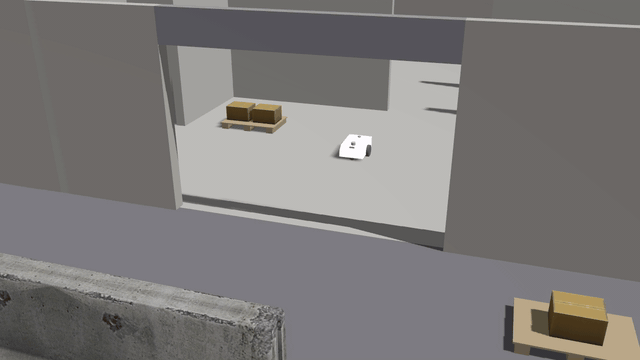

# Fieldproof

[](https://github.com/Dimitrios-Kafetzis/Fieldproof/actions/workflows/ci.yml)
[](https://github.com/Dimitrios-Kafetzis/Fieldproof/actions/workflows/images.yml)
[](https://github.com/Dimitrios-Kafetzis/Fieldproof/actions/workflows/scenario-tests.yml)
[](https://dimitrios-kafetzis.github.io/Fieldproof/)
[](LICENSE)

**Run the real stack. Prove it before the field.**

Fieldproof is a multi-domain robotics emulation and simulation platform. Ground robots (UGV), drones
(UAV) and surface vessels (USV) run their *unmodified* ROS 2 (and bridged ROS 1) codebases inside
isolated containers, fed by simulated sensors from a physics engine, orchestrated by a declarative
scenario engine, and observed through a browser-based 3D cockpit. Every scenario is an automated
test with pass/fail assertions, so field testing becomes verification of what already passed.

> Status: milestone M2 (the scenario engine: fleets, faults, two clocks) closed with v0.20.1;
> M1 (the first scenario passes, in CI too) closed with v0.10.0. Phase 2 delivered fleets of
> vehicles (P2-T01), radio links between the vehicles and a ground station (P2-T02), the event
> injection framework (P2-T03), the two clock modes and determinism (P2-T04), the assertion
> library (P2-T05), run matrices and the run database (P2-T06), field log replay (P2-T07) and
> the vehicle onboarding SDK (P2-T08: `fieldproof vehicle init`, an external repository as a
> workspace, the worked example `fieldproof-example-vehicle`). Phase 3, the cockpit, is next.
> See [docs/plan/STATUS.md](docs/plan/STATUS.md).

## See it run


The milestone M2 demo, `make demo-m2`, as Fieldproof records it from the depot's cameras: a
fleet of three UGVs with namespaces and resource budgets driving in the yard, the dock and the
hall; a crate dropped in a vehicle's path by the timeline and Nav2 replanning around it; a
vehicle holding in place while the radio link to its ground station is cut, then driving on when
it returns; the simulator paused, stepped and resumed under a driving vehicle; two lockstep runs
side by side, their trajectories compared; a GNSS denial that a SLAM stack never notices; the
drive real-time-locked; a run matrix with one JUnit document; a field log replayed into the SLAM
stack and its localisation judged; and the external example vehicle repository, with a navigator
of its own, run through its own Makefile. Every clip is a scenario with pass/fail assertions.
[The full-resolution MP4](https://github.com/Dimitrios-Kafetzis/Fieldproof/releases/download/v0.20.1/fieldproof-m2-demo.mp4)
(3 min 26 s) is attached to the v0.20.1 release;
[docs/reference/demo-m2.md](docs/reference/demo-m2.md) says how it was made.



The first scenario (milestone M1) as Fieldproof itself records it: the example UGV, running an
unmodified Nav2 and SLAM Toolbox stack in its own container, drives from the depot's loading
dock through the roller door to a goal in the yard while five assertions check the run. The
clips come from camera sensors in the world (`fieldproof run --video`, or `outputs.video` in a
scenario), encoded headlessly by the simulator and saved into the run directory next to the
MCAP recording and the reports;
[the M1 MP4](https://github.com/Dimitrios-Kafetzis/Fieldproof/releases/download/v0.10.0/fieldproof-m1-demo.mp4)
is attached to the v0.10.0 release. Every run of the quick start below produces its own under
`runs/<run_id>/video/`.

## Quick start

The first scenario on an Ubuntu 24.04 workstation with Docker: the example UGV (a differential-drive
robot running Nav2 and SLAM Toolbox, unmodified, in its own container) drives to a goal in the depot
world while five assertions check the run and its topics are recorded to MCAP.

```bash
git clone https://github.com/Dimitrios-Kafetzis/Fieldproof.git
cd Fieldproof
tools/host-setup.sh      # once: Docker, Node, uv, pre-commit (asks for sudo); log out and back in
examples/demo_m1.sh      # or: make demo
```

The demo pulls the published images (about 7 GB the first time), fetches the pinned Gazebo Fuel
models, builds the example vehicle image on the published base (a few minutes) and runs
`fieldproof run examples/scenarios/ugv_nav_to_goal.yaml`. It ends with `PASS`, one line per
assertion, the report (`runs/<run_id>/report.md`, `report.json`, `junit.xml`), the video of the
drive (`runs/<run_id>/video/spectator.mp4`) and the MCAP recording (`runs/<run_id>/recording/`),
which opens in [Foxglove Studio](https://foxglove.dev/) to show the robot's path. The same chain
runs on every push to `main` and nightly in the
[Scenario tests](https://github.com/Dimitrios-Kafetzis/Fieldproof/actions/workflows/scenario-tests.yml)
workflow ([docs/setup/ci.md](docs/setup/ci.md#scenario-tests)).

`examples/demo_m1.sh --local` uses images built with `make images`
([docs/setup/containers.md](docs/setup/containers.md)), `FIELDPROOF_RENDER=software` forces
software rendering on a host without a GPU render node, and `--help` lists the rest. Then read
[docs/reference/scenarios.md](docs/reference/scenarios.md) to write a scenario of your own and
[docs/reference/onboarding.md](docs/reference/onboarding.md) to bring your own vehicle: a
repository of your own next to the checkout, scaffolded by `fieldproof vehicle init`, with its
manifest ([docs/reference/manifest.md](docs/reference/manifest.md)), its scenarios and its own
CI, the way [fieldproof-example-vehicle](examples/fieldproof-example-vehicle/) does.
`make demo-m2` runs the whole of milestone M2 in turn (the fleet, a dropped radio link, events
and faults, the two clocks, a run matrix, a replayed field log, the onboarded repository). On a
workstation, `make run SCENARIO=examples/scenarios/ugv_fleet.yaml` runs three of the example
UGVs at once, each in its own container, namespace and budget
([docs/reference/scenarios.md#fleets](docs/reference/scenarios.md#fleets)), and
`make run SCENARIO=examples/scenarios/ugv_link_loss.yaml` drops the example vehicle's LTE link to
its ground station for 20 s while it drives and checks that it holds position until the link is
back ([docs/reference/network.md](docs/reference/network.md)).

## Documentation map

The same documents are published as a site at https://dimitrios-kafetzis.github.io/Fieldproof/
on every merge to `main` ([docs/setup/docs.md](docs/setup/docs.md)).

| Document | Purpose |
| --- | --- |
| [docs/plan/00-overview.md](docs/plan/00-overview.md) | Vision, principles, fidelity tiers, glossary |
| [docs/plan/01-architecture.md](docs/plan/01-architecture.md) | Layers, components, interfaces, data flow |
| [docs/plan/02-roadmap.md](docs/plan/02-roadmap.md) | Phases, milestones, exit criteria |
| [docs/plan/03-task-backlog.md](docs/plan/03-task-backlog.md) | Every task, one working session each |
| [docs/plan/04-engineering-standards.md](docs/plan/04-engineering-standards.md) | Repo layout, branching, testing, CI, quality gates |
| [docs/plan/05-working-model.md](docs/plan/05-working-model.md) | How a task session runs, hand-off, what the maintainer provides |
| [docs/plan/06-session-guide.md](docs/plan/06-session-guide.md) | Rules every working session follows from start to hand-off |
| [docs/plan/STATUS.md](docs/plan/STATUS.md) | Live task board, updated at the end of every session |
| [docs/adr/](docs/adr/) | Architecture Decision Records |
| [docs/setup/host.md](docs/setup/host.md) | Prepare an Ubuntu 24.04 workstation: `tools/host-setup.sh`, `tools/host-check.sh` |
| [docs/setup/tooling.md](docs/setup/tooling.md) | Quality gates: `make setup`, `make lint`, `make fmt`, `make test`, commit message rules |
| [docs/setup/containers.md](docs/setup/containers.md) | Container images, pins, rendering modes, `make images`/`up`/`shell`/`down` |
| [docs/setup/ci.md](docs/setup/ci.md) | GitHub Actions workflows, required checks, published image tags, releases, Dependabot |
| [docs/setup/docs.md](docs/setup/docs.md) | The documentation site: `make docs`, `make docs-serve`, writing pages, the generated ADR index, deployment |
| [docs/setup/workspaces.md](docs/setup/workspaces.md) | Repository layout and workspaces: `make test-engine`, `make test-cockpit`, `make test-ros`, `make tidy`, one version everywhere |
| [docs/reference/](docs/reference/index.md) | Reference pages, starting with the [CLI](docs/reference/cli.md) |
| [examples/](examples/README.md) | The example scenarios and vehicle, and `examples/demo_m1.sh`, the M1 demo of the quick start |
| [ARCHITECTURE.md](ARCHITECTURE.md) | Which directory is which layer, and where its documentation lives |

## Core principle

The robot code never knows it is in Fieldproof. Only hardware driver nodes are swapped for simulated
sensor sources publishing identical topics and message types, and the clock may be simulated. Perception,
localisation, planning, control and mission logic run exactly as they do on the vehicle.

## Repository

https://github.com/Dimitrios-Kafetzis/Fieldproof

## Licence

Apache-2.0. See [LICENSE](LICENSE) and [NOTICE](NOTICE).
