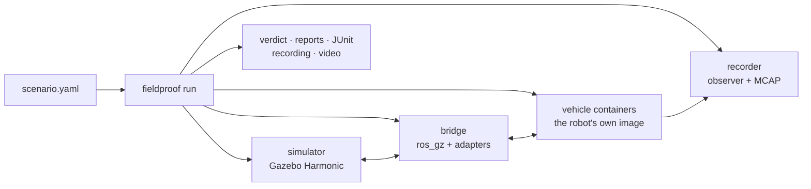

<div align="center">

# Fieldproof

**Run the real stack. Prove it before the field.**

[](https://github.com/Dimitrios-Kafetzis/Fieldproof/actions/workflows/ci.yml)
[](https://github.com/Dimitrios-Kafetzis/Fieldproof/actions/workflows/images.yml)
[](https://github.com/Dimitrios-Kafetzis/Fieldproof/actions/workflows/scenario-tests.yml)
[](https://dimitrios-kafetzis.github.io/Fieldproof/)
[](https://github.com/Dimitrios-Kafetzis/Fieldproof/releases/latest)
[](LICENSE)

Fieldproof runs a robot's *unmodified* ROS 2 code against a physics simulation, in containers,
under a declarative scenario with pass/fail assertions, so that what reaches the field has
already passed.

[Quick start](#quick-start) ·
[What it does](#what-it-does) ·
[How a run works](#how-a-run-works) ·
[Roadmap](#roadmap) ·
[Documentation](https://dimitrios-kafetzis.github.io/Fieldproof/)

</div>

## See it run


Milestone M2, *fleet, faults, two clocks*, as Fieldproof records it from the simulated world's
own cameras: a fleet of three UGVs, each in its own container with its own namespace and budget;
a crate dropped in a vehicle's path by the timeline and Nav2 replanning around it; a vehicle
holding while the radio link to its ground station is cut, then driving on; the simulator paused,
stepped and resumed under a driving vehicle; two lockstep runs side by side with identical
trajectories; a GNSS denial a SLAM stack never notices; a run matrix with one JUnit document; a
field log replayed into the stack and its localisation judged; and an external vehicle
repository, with a navigator of its own, run through its own Makefile. Every clip is a scenario
whose assertions passed.

[Watch the full video](https://github.com/Dimitrios-Kafetzis/Fieldproof/releases/download/v0.20.1/fieldproof-m2-demo.mp4)
(3 min 26 s, MP4) or read [how it was made](docs/reference/demo-m2.md). The whole milestone
runs on one machine with `make demo-m2`.

<details>
<summary>The first scenario (milestone M1)</summary>


The example UGV, running an unmodified Nav2 and SLAM Toolbox stack in its own container, drives
from the depot's loading dock through the roller door to a goal in the yard while five assertions
check the run. This is what the quick start below runs; the
[M1 MP4](https://github.com/Dimitrios-Kafetzis/Fieldproof/releases/download/v0.10.0/fieldproof-m1-demo.mp4)
is attached to the v0.10.0 release.

</details>

## Why

Field time is the scarcest resource a robotics team has, and most of it goes to finding what a
test bench could have found. Fieldproof turns the questions a field day answers into scenarios
that run on a workstation and in CI:

- **The robot code never knows it is in Fieldproof.** Only the hardware driver nodes are swapped
  for simulated sensor sources that publish the same topics, types, frames and rates, and the
  clock may be simulated. Perception, localisation, planning, control and mission logic run
  exactly as they do on the vehicle, in the vehicle's own container image.
- **Every scenario is a test.** A YAML file names the world, the vehicles, a timeline of events
  and the assertions that decide the verdict. A run ends with `PASS` or `FAIL`, a report, a JUnit
  document for CI and an MCAP recording of everything the stack saw.
- **The hard cases are reproducible.** A radio link that drops mid-drive, a crate that appears in
  the path, a GNSS fix that goes away, a sensor that freezes, a fleet that competes for a budget:
  each is a line in the timeline, replayed exactly, seed by seed.

## What it does

| | Today, with v0.20 |
| --- | --- |
| **Scenarios** | [YAML scenarios](docs/reference/scenarios.md) with a versioned schema: world, vehicles, spawn frames, a timeline (`at`, `after`, `when`, `every`), assertions, KPIs, budgets and outputs. `fieldproof validate`, `fieldproof run`, `--set` overrides. |
| **Vehicles** | One container per vehicle, built from a [manifest](docs/reference/manifest.md) (`robot.yaml`): the image or its build, the entrypoint, the driver-swap map, readiness conditions and a CPU and memory budget. Fleets with namespaces, one TF tree each. |
| **Assertions** | A [library of sixteen checks](docs/reference/assertions.md): reach a pose, finish in time, topic rates, message latency, no collision, geofence, minimum distance, path efficiency, mission time, lifecycle state, resource usage, ordered sequences, `always`/`never`/`eventually` over any signal, localisation error. Each with evidence in the report. |
| **Events and faults** | [Timeline events](docs/reference/events.md): navigation goals, parameter changes, container pause, kill and resume, simulator pause, step and resume, world events (spawn, remove, teleport, wind) and sensor faults (GNSS denial and offset, IMU bias, sensor dropout and freeze, battery drain, actuator limits). Plugins add their own. |
| **Radio links** | [Emulated links](docs/reference/network.md) between each vehicle and a ground station: latency, loss and bandwidth profiles, drops and restores from the timeline, the measurement verified against the profile. |
| **Two clocks** | [Simulation time, a real-time lock and lockstep](docs/reference/time.md): the drift measured, two lockstep runs compared trajectory by trajectory, seeds fixed. |
| **Run matrices** | [Sweeps over parameters and seeds](docs/reference/matrix.md) with resource-aware scheduling, retries and flake flagging, one JUnit document per matrix, every run in a SQLite database with HTML reports and diffs. |
| **Field log replay** | [A recorded MCAP or rosbag2](docs/reference/replay.md) played into the stack instead of the simulator, the clock from the log, the estimate judged against the log's ground truth. |
| **Onboarding** | [Bring your own vehicle](docs/reference/onboarding.md) from a repository of your own, scaffolded by `fieldproof vehicle init`, with its own CI, without touching Fieldproof's source. The worked example is [`fieldproof-example-vehicle`](examples/fieldproof-example-vehicle/). |
| **Evidence** | Every run writes `report.md`, `report.json`, `report.html` and `junit.xml`, an MCAP recording that opens in Foxglove Studio, the containers' logs, and a video from a camera of the world on request. |

The reference vehicle is a differential-drive UGV running Nav2 and SLAM Toolbox in a depot world.
Drones (PX4 and ArduPilot), surface vessels, a browser cockpit and hardware-fidelity tiers follow
on the [roadmap](#roadmap).

## Quick start

On an Ubuntu 24.04 workstation with Docker ([host setup](docs/setup/host.md)):

```bash
git clone https://github.com/Dimitrios-Kafetzis/Fieldproof.git
cd Fieldproof
tools/host-setup.sh      # once: Docker, Node, uv, pre-commit (asks for sudo); log out and back in
examples/demo_m1.sh      # or: make demo
```

The demo pulls the published images (about 7 GB the first time), fetches the pinned Gazebo Fuel
models, builds the example vehicle image on the published base and runs
`fieldproof run examples/scenarios/ugv_nav_to_goal.yaml`. It ends with `PASS`, one line per
assertion, and leaves the report, the video of the drive and the MCAP recording under
`runs/<run_id>/`. The same chain runs on every push to `main` and nightly in the
[Scenario tests](https://github.com/Dimitrios-Kafetzis/Fieldproof/actions/workflows/scenario-tests.yml)
workflow.

Then:

- **Write a scenario.** Start from [`examples/scenarios/`](examples/scenarios/) and the
  [scenario reference](docs/reference/scenarios.md); `fieldproof validate` checks it against the
  schema before anything starts.
- **Bring your own vehicle.** `fieldproof vehicle init my-robot` scaffolds a repository next to
  the checkout with a manifest, a smoke scenario, a bringup package and a Makefile; the
  [onboarding guide](docs/reference/onboarding.md) walks through the driver swap, QoS, simulation
  time, readiness and budgets.
- **Run a fleet or drop a link.** `make run SCENARIO=examples/scenarios/ugv_fleet.yaml` runs
  three UGVs at once; `make run SCENARIO=examples/scenarios/ugv_link_loss.yaml` cuts the
  example vehicle's LTE link mid-drive and checks that it holds until the link is back.
- **Run the whole milestone.** `make demo-m2` runs every step of M2 in turn and ends with a
  table of verdicts (`--quick` skips the fleet).

`examples/demo_m1.sh --local` uses images built with `make images`
([containers](docs/setup/containers.md)); `FIELDPROOF_RENDER=software` forces software rendering
on a host without a GPU render node; `--help` lists the rest.

## How a run works



The engine reads the scenario, starts the simulator with the world, generates the bridge from the
vehicles' manifests (the driver-swap map decides which topics the simulation feeds), starts one
container per vehicle from its own image, waits for each stack's readiness conditions, then plays
the timeline while the observer evaluates the assertions on what the stack publishes. The
teardown leaves the run directory behind: the verdict, the reports, the recording and the logs.

| Layer | Directory | What it holds |
| --- | --- | --- |
| Physics and sensors | [`sim/`](sim/) | Gazebo worlds and system plugins (C++17) |
| Bridge | [`bridge/`](bridge/) | the ros_gz configuration generator and adapter nodes, the bridge contract |
| Reference vehicles | [`robots/`](robots/) | the reference UGV: URDF, SDF, manifest |
| Scenario engine | [`engine/`](engine/) | the `fieldproof` CLI: scenarios, runner, assertions, events, matrices, replay (Python) |
| Cockpit | [`cockpit/`](cockpit/) | the browser cockpit (TypeScript, Three.js), milestone M3 |
| Images | [`docker/`](docker/) | the container images and the local compose stack |
| Examples | [`examples/`](examples/) | scenarios, matrices, the example vehicle repository, the demos |

[ARCHITECTURE.md](ARCHITECTURE.md) maps every directory to its layer;
[docs/plan/01-architecture.md](docs/plan/01-architecture.md) describes the layers, their
interfaces and the data flow; the [ADRs](docs/adr/README.md) record the decisions.

## Roadmap

| Milestone | Scope | Status |
| --- | --- | --- |
| **M0** Hello, CI | repository, images, quality gates, documentation site | closed, v0.3.0 |
| **M1** First scenario passes | a UGV running real Nav2 reaches a goal, recorded and reported, in CI too | closed, v0.10.0 |
| **M2** Fleet, faults, two clocks | fleets, radio links, events and faults, two clocks, run matrices, field log replay, vehicle onboarding | closed, v0.20.1 |
| **M3** Watch and steer in the browser | the cockpit: 3D twin, sensors, fleet telemetry, live assertions, event injection, replay scrubbing | next |
| **M4** Mission under wind and GPS loss | quadrotors on PX4 and ArduPilot, wind gusts, GPS denial, failsafes | planned |
| **M5** Station-keeping in sea state 3 | a catamaran USV in a harbour world with waves, wind and current | planned |
| **M6** Same binary, same timing, same radio | ARM64 images under QEMU, calibrated sensor noise, HIL, ROS 1 bridged, sim-vs-field divergence | planned |
| **M7** v1.0 | scenario library, world editor, run dashboard, plugin SDK, signed images, tutorials | planned |

The [roadmap](docs/plan/02-roadmap.md) has the exit criteria, the
[backlog](docs/plan/03-task-backlog.md) every task, and the
[status board](docs/plan/STATUS.md) is updated at the end of every working session.

## Documentation

Published at https://dimitrios-kafetzis.github.io/Fieldproof/ on every merge to `main`.

| | |
| --- | --- |
| **Reference** | [CLI](docs/reference/cli.md) · [Scenarios](docs/reference/scenarios.md) · [Assertions and reports](docs/reference/assertions.md) · [Events](docs/reference/events.md) · [Radio links](docs/reference/network.md) · [Time and determinism](docs/reference/time.md) · [Run matrices](docs/reference/matrix.md) · [Field log replay](docs/reference/replay.md) · [Vehicle manifest](docs/reference/manifest.md) · [Onboarding](docs/reference/onboarding.md) · [Worlds](docs/reference/worlds.md) · [Reference vehicles](docs/reference/robots.md) · [Bridge contract](docs/reference/bridge.md) · [Troubleshooting](docs/reference/troubleshooting.md) |
| **Setup** | [Host](docs/setup/host.md) · [Tooling and quality gates](docs/setup/tooling.md) · [Containers](docs/setup/containers.md) · [Workspaces](docs/setup/workspaces.md) · [CI and releases](docs/setup/ci.md) · [The documentation site](docs/setup/docs.md) |
| **Plan** | [Overview](docs/plan/00-overview.md) · [Architecture](docs/plan/01-architecture.md) · [Roadmap](docs/plan/02-roadmap.md) · [Backlog](docs/plan/03-task-backlog.md) · [Engineering standards](docs/plan/04-engineering-standards.md) · [Working model](docs/plan/05-working-model.md) · [Session guide](docs/plan/06-session-guide.md) · [Status board](docs/plan/STATUS.md) · [ADRs](docs/adr/README.md) |

## Contributing

Fieldproof is developed in the open, one task per working session, with the plan, the standards
and the status board in the repository. [CONTRIBUTING.md](CONTRIBUTING.md) explains how to
propose a change, the [engineering standards](docs/plan/04-engineering-standards.md) what every
change must pass (`make lint`, `make test`, Conventional Commits), and
[SECURITY.md](SECURITY.md) how to report a vulnerability. Everyone taking part is expected to
follow the [code of conduct](CODE_OF_CONDUCT.md).

## Licence

Apache-2.0. See [LICENSE](LICENSE) and [NOTICE](NOTICE).
