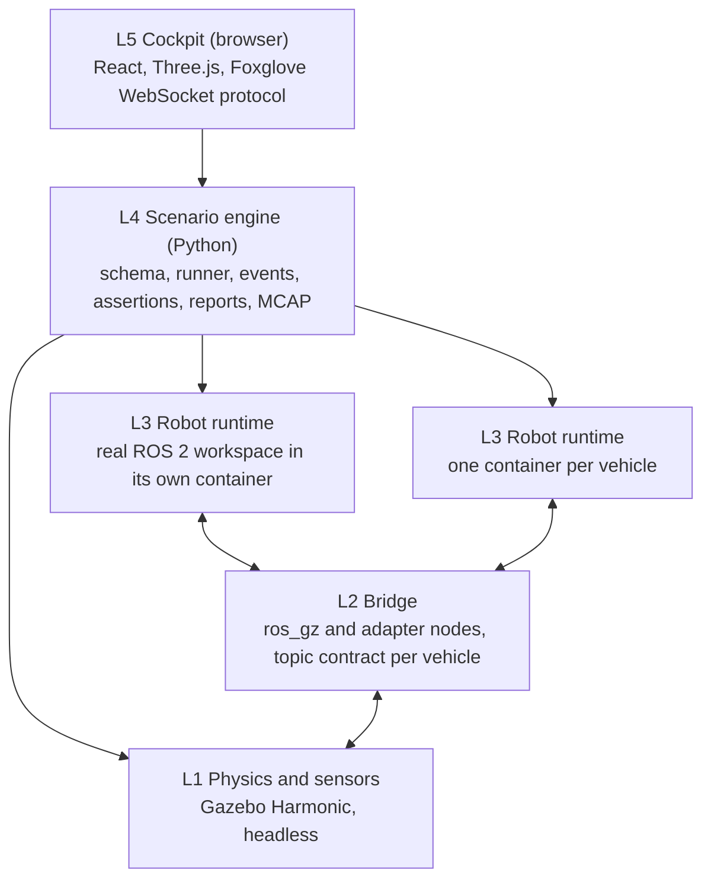

# Fieldproof

**Run the real stack. Prove it before the field.**

Fieldproof is a multi-domain robotics emulation and simulation platform. Ground robots (UGV),
drones (UAV) and surface vessels (USV) run their *unmodified* ROS 2 (and bridged ROS 1) codebases
inside isolated containers, fed by simulated sensors from a physics engine, orchestrated by a
declarative scenario engine, and observed through a browser-based 3D cockpit. Every scenario is an
automated test with pass/fail assertions, so field testing becomes verification of what already
passed.

!!! note "Status"
    Phase 0 (Foundations) is in progress. The [status board](plan/STATUS.md) is updated at the end
    of every working session; the [roadmap](plan/02-roadmap.md) lists the milestones.

## The core principle

The robot code never knows it is in Fieldproof. Only hardware driver nodes are swapped for
simulated sensor sources publishing identical topics and message types, and the clock may be
simulated. Perception, localisation, planning, control and mission logic run exactly as they do
on the vehicle.

Dependencies point downward only: the simulator knows nothing about scenarios, the robot code
knows nothing about any of it. The [architecture](plan/01-architecture.md) describes each layer.

## Where to go

- :material-map-outline: **Plan**

    ---

    The [overview](plan/00-overview.md) (vision, principles, fidelity tiers), the
    [architecture](plan/01-architecture.md), the [roadmap](plan/02-roadmap.md), the
    [task backlog](plan/03-task-backlog.md) and the [engineering standards](plan/04-engineering-standards.md).

- :material-scale-balance: **Decisions**

    ---

    The [Architecture Decision Records](adr/README.md): the engine, the ROS versions, the cockpit,
    the container model, the scenario format, the clock, the fidelity tiers, the repository and
    the languages.

- :material-wrench-outline: **Setup**

    ---

    Prepare a [workstation](setup/host.md), install the [quality gates](setup/tooling.md),
    build and run the [container images](setup/containers.md), and read how
    [CI/CD](setup/ci.md) and [this site](setup/docs.md) are produced.

- :material-book-open-variant: **Reference**

    ---

    [Reference pages](reference/index.md) for the CLI, the scenario schema, events, assertions and
    vehicle manifests, generated from the schemas as the engine takes shape.

## How the project is built

One backlog task per working session, following the [working model](plan/05-working-model.md)
and the [session guide](plan/06-session-guide.md). Code, tests and documentation ship in the same
pull request, squash-merged to `main` with a Conventional Commit title, and this site is rebuilt
from `docs/` on every merge.

The source is on GitHub at
[Dimitrios-Kafetzis/Fieldproof](https://github.com/Dimitrios-Kafetzis/Fieldproof) under the
Apache-2.0 licence.
