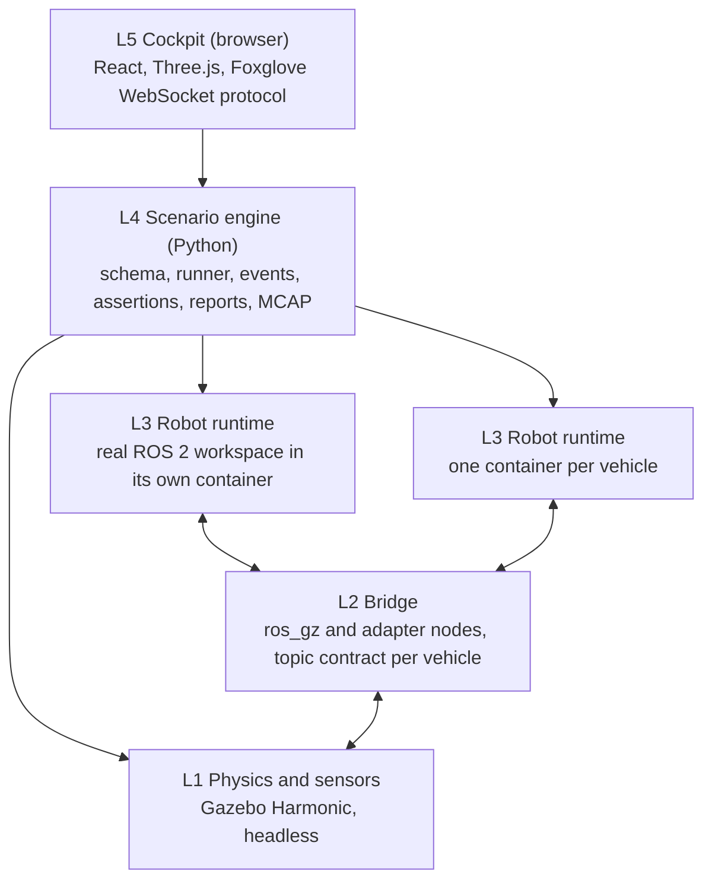

# Fieldproof

**Run the real stack. Prove it before the field.**

Fieldproof is a multi-domain robotics emulation and simulation platform. Ground robots (UGV),
drones (UAV) and surface vessels (USV) run their *unmodified* ROS 2 (and bridged ROS 1) codebases
inside isolated containers, fed by simulated sensors from a physics engine, orchestrated by a
declarative scenario engine, and observed through a browser-based 3D cockpit. Every scenario is an
automated test with pass/fail assertions, so field testing becomes verification of what already
passed.

!!! note "Status"
    Milestone M2 (the scenario engine: fleets, faults, two clocks) closed with v0.20.1; M1 (the
    first scenario passes, in CI too) closed with v0.10.0. Phase 3, the cockpit, is next. The
    [status board](plan/STATUS.md) is updated at the end of every working session; the
    [roadmap](plan/02-roadmap.md) lists the milestones.


The milestone M2 demo, `make demo-m2`, as Fieldproof records it from the depot's cameras
([the video output](reference/scenarios.md#video)): a fleet of three UGVs, a crate dropped in a
vehicle's path and Nav2 replanning around it, a vehicle holding while its radio link is cut, the
simulator paused, stepped and resumed under a driving vehicle, two lockstep runs side by side,
a GNSS denial, the real-time lock, a run matrix, a field log replayed into the SLAM stack and
the external example vehicle repository run through its own Makefile; every clip is a scenario
with pass/fail assertions. [How the video was made](reference/demo-m2.md); the full-resolution
MP4 is attached to the
[v0.20.1 release](https://github.com/Dimitrios-Kafetzis/Fieldproof/releases/tag/v0.20.1).


The first scenario (milestone M1): the example UGV, running an unmodified Nav2 and SLAM Toolbox
stack in its own container, drives from the loading dock through the roller door to a goal in
the yard while five assertions check the run.

## Quick start

On an Ubuntu 24.04 workstation with Docker ([host setup](setup/host.md)):

```bash
git clone https://github.com/Dimitrios-Kafetzis/Fieldproof.git
cd Fieldproof
tools/host-setup.sh      # once: Docker, Node, uv, pre-commit (asks for sudo); log out and back in
examples/demo_m1.sh      # or: make demo
```

The demo pulls the published images, fetches the pinned Gazebo Fuel models, builds the example
vehicle image and runs `fieldproof run examples/scenarios/ugv_nav_to_goal.yaml`: the example UGV
(Nav2 and SLAM Toolbox, unmodified, in its own container) drives to a goal in the depot world
while five [assertions](reference/assertions.md) check the run and its topics are recorded to
MCAP. It ends with `PASS`, the report, the video of the drive and the recording, which opens in
Foxglove Studio. The
same chain runs on every push to `main` in the [Scenario tests](setup/ci.md#scenario-tests)
workflow. The [scenario reference](reference/scenarios.md) says how to write your own, the
[vehicle manifest](reference/manifest.md) how to bring your own vehicle.

## The core principle

The robot code never knows it is in Fieldproof. Only hardware driver nodes are swapped for
simulated sensor sources publishing identical topics and message types, and the clock may be
simulated. Perception, localisation, planning, control and mission logic run exactly as they do
on the vehicle.



Dependencies point downward only: the simulator knows nothing about scenarios, the robot code
knows nothing about any of it. The [architecture](plan/01-architecture.md) describes each layer.

## Where to go

<div class="grid cards" markdown>

- :material-map-outline: **Plan**

    ---

    The [overview](plan/00-overview.md) (vision, principles, fidelity tiers), the
    [architecture](plan/01-architecture.md), the [roadmap](plan/02-roadmap.md), the
    [task backlog](plan/03-task-backlog.md) and the [engineering standards](plan/04-engineering-standards.md).

- :material-scale-balance: **Decisions**

    ---

    The [Architecture Decision Records](adr/README.md): the engine, the ROS versions, the cockpit,
    the container model, the scenario format, the clock, the fidelity tiers, the repository and
    the languages.

- :material-wrench-outline: **Setup**

    ---

    Prepare a [workstation](setup/host.md), install the [quality gates](setup/tooling.md),
    build and run the [container images](setup/containers.md), find your way around the
    [workspaces](setup/workspaces.md), and read how [CI/CD](setup/ci.md) and
    [this site](setup/docs.md) are produced.

- :material-book-open-variant: **Reference**

    ---

    [Reference pages](reference/index.md) for the CLI, the scenario schema, events, assertions and
    vehicle manifests, generated from the schemas as the engine takes shape.

</div>

## How the project is built

One backlog task per working session, following the [working model](plan/05-working-model.md)
and the [session guide](plan/06-session-guide.md). Code, tests and documentation ship in the same
pull request, squash-merged to `main` with a Conventional Commit title, and this site is rebuilt
from `docs/` on every merge.

The source is on GitHub at
[Dimitrios-Kafetzis/Fieldproof](https://github.com/Dimitrios-Kafetzis/Fieldproof) under the
Apache-2.0 licence.
