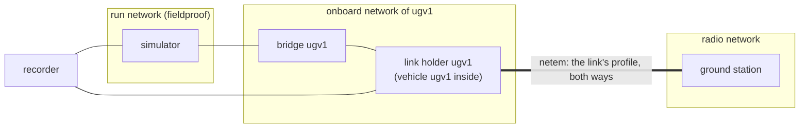

# Radio links

A scenario with a `network` section runs every vehicle behind its own radio link to a ground
station (task P2-T02, [ADR-0004](../adr/0004-one-container-per-vehicle.md): each vehicle has its
own network namespace, and netem attaches to it). A link has a **profile** (latency, jitter,
loss, reordering, rate); the timeline changes it (`link.set`), cuts it (`link.drop`) and brings it
back (`link.restore`); the ground station measures every link while the run lasts, and the run
checks what it measured against the profiles. The example
[`ugv_link_loss.yaml`](https://github.com/Dimitrios-Kafetzis/Fieldproof/blob/main/examples/scenarios/ugv_link_loss.yaml)
drops the example vehicle's LTE link for 20 s while it drives and asserts its documented
loss-of-link behaviour.

```yaml
network:
  profile: lte_rural              # every vehicle's link: a preset or a name under `profiles`
  links: { ugv2: far_modem }      # a vehicle's own profile instead
  profiles:
    far_modem: { latency_ms: 80, jitter_ms: 10, loss_pct: 2, rate_kbit: 64 }
  verify: fail                    # off | warn (default) | fail
timeline:
  - { at: 5s, name: link_outage, vehicle: ugv1, action: link.drop, duration_s: 20s }
  - { at: 40s, vehicle: ugv2, action: link.set, profile: rf_900mhz_5km }
  - { at: 60s, vehicle: ugv2, action: link.restore }
```

Without a `network` section nothing changes: the vehicles share the run's Docker network as
before, unshaped.

## Topology



| Network | Members | What crosses it |
| --- | --- | --- |
| the run's network (`docker.network`, `fieldproof`) | the simulator, every bridge, the recorder | Gazebo transport, `/clock` |
| `fieldproof-<short>-onboard-<vehicle>`, one per vehicle | the vehicle's link holder (so the vehicle), its bridge, the recorder; the bridge that publishes `/clock` joins every onboard network | the vehicle's sensors and actuators (its bridge) and the recorder's view of it: never shaped |
| `fieldproof-<short>-radio` | every link holder, the ground station | what a vehicle says to the ground or to another vehicle: through the sender's link and the receiver's |

- **The link holder** (`fieldproof-<short>-link-<vehicle>`, role `link`) is a container of the
  bridge image running `sleep infinity` as root with `NET_ADMIN`, on the onboard network with
  the radio network joined before it starts (DNS name: the vehicle's name on both). The vehicle
  container joins its network namespace (`--network container:<holder>`), the way a pod's
  containers share one, so the link is shaped from the vehicle's first packet and the stack
  under test gets no privilege. The vehicle's hostname is the holder's (the vehicle's name).
- **The ground station** (`fieldproof-<short>-ground`, role `ground`) is the bridge image
  running `engine/src/fieldproof/ground.py`, mounted from the engine like the observer, as the
  engine's user, on the radio network only. It sends each vehicle the heartbeat its manifest
  asks for and probes every link ([Measurement](#measurement)).
- **The bridges** sit on two networks (the run's and the vehicle's onboard one; the clock
  bridge on every onboard network). gz-transport advertises the address of the container's
  first interface, and Docker does not keep the order of a container's interfaces stable, so a
  bridge could advertise its onboard address, which the simulator cannot reach: its `cmd_vel`
  would never arrive while the odometry still flowed. A bridge behind a link therefore starts
  through a wrapper that sets `GZ_IP` to its address on the route to the simulator
  (`FIELDPROOF_SIM_HOST`, `ip route get`).
- **The recorder** joins every onboard network, so what it records and what the assertions see
  is the vehicles' truth, not the ground station's view of them. It is not on the radio network
  (its subscriptions would pull every recorded topic over the links), so it does not hear the
  ground station itself: the heartbeat is visible through what the vehicle does with it
  (`link_state` in the example), the link through `/fieldproof/network`.
- **Vehicle to vehicle** traffic crosses the sender's link and the receiver's (a star through
  the radio network, as through a base station or a mesh relay): ugv1's onboard network and
  ugv2's share no member that would carry it otherwise.

The `network` phase, between `recorder` and `vehicles`, starts the holders (in parallel), puts
each link's configured profile on it (`link.applied`), then starts the ground station and waits
for its `ready` line (`timeouts.ground_s`, 60 s). The teardown removes the holders and the
ground station with the other containers, then the run's networks, then any network labelled
with the run id. `--keep` keeps the networks too.

Refused: radio links with `discovery: server` (the discovery server would sit on one side of
every link; the plan says so). Fast DDS discovers over multicast on each network, which a
vehicle's own DDS profile does not need to know about.

## Profiles

A profile describes each direction of the link: a vehicle's outbound and inbound traffic both
carry it, so `latency_ms` is one way and a round trip takes twice as long.

| Field | Meaning |
| --- | --- |
| `latency_ms` | delay of every packet, one way |
| `jitter_ms` | standard deviation of the delay (a normal distribution around `latency_ms`; needs a latency) |
| `loss_pct` | packets lost, each direction, independently |
| `reorder_pct` | packets sent at once instead of delayed, so they overtake the delayed ones (needs a latency) |
| `rate_kbit` | throughput of each direction; a burst queues (up to 1000 packets) and what does not fit is dropped, as in a radio modem's buffer |
| `description` | what the profile stands for |

| Preset | Latency | Jitter | Loss | Rate | Stands for |
| --- | --- | --- | --- | --- | --- |
| `wifi_good` | 5 ms | 2 ms | 0.1 % | 50 Mbit/s | 802.11ac in line of sight of the access point, light contention |
| `lte_rural` | 60 ms | 20 ms | 1 % | 4 Mbit/s | LTE at the edge of a rural cell: long and variable delay, a few Mbit/s up |
| `rf_900mhz_5km` | 40 ms | 10 ms | 3 % | 200 kbit/s | a 900 MHz telemetry modem at 5 km: low throughput, frequent loss |

A scenario's own profiles go under `network.profiles` (they may not reuse a preset's name);
`drop` is the profile a dropped link carries (100 % loss).

### How a profile is applied

The holder runs a script (`fieldproof.network.link_script`) that finds its radio interface by
the address Docker gave it, creates an `ifb` device and redirects the interface's inbound
traffic to it, and gives both (outbound on the interface, inbound on the `ifb` device) the same
tree:

```text
root 1: prio, 2 bands
├── band 1:1 ← ICMP (the ground station's probes) → netem 10: latency, jitter, loss, reordering
└── band 1:2 ← everything else                    → netem 20: latency, jitter, loss, reordering, rate
```

`tc qdisc replace` changes the netem queues in place, so `link.set`, `link.drop` and
`link.restore` run the same script with another profile. The probes have their own band so they
measure what the profile sets, not the queue the traffic builds behind the rate (see
[Discovery over a slow link](#discovery-over-a-slow-link)); the traffic band's counters show
that queue.

The host kernel must provide the `sch_netem` and `ifb` modules; Ubuntu loads them on demand
from a container with `NET_ADMIN`, and CI loads them explicitly. Without them the `network`
phase fails with the `tc` error and the hint `sudo modprobe sch_netem ifb`.

## Timeline events

| Action | Fields | Effect |
| --- | --- | --- |
| `link.set` | `vehicle`, `profile` | the profile from now on |
| `link.drop` | `vehicle`, `duration_s` (optional) | 100 % loss both ways; with `duration_s` the entry restores the configured profile after that long and ends then (so `within_time` and the record see the outage's length); without it the link stays down until a `link.set` or `link.restore` |
| `link.restore` | `vehicle` | the profile the scenario configures for the link (`links.<vehicle>` or `profile`) |

They take the triggers of the timeline DSL (`at`, `after`, `when`, `every`; task P2-T03,
[events.md](events.md#the-timeline-dsl)) and `name` like every entry and run on the timeline's
workers, so a 20 s drop runs while the vehicle drives. A link event needs a `network` section;
a `link.set` profile must be known. The record's `timeline` has each entry's outcome (`dropped
for 20 s, lte_rural restored`). They are events of the plugin API like the rest
(`fieldproof.events.link`).

## Measurement

The ground station probes each link with ICMP echoes (16 bytes of payload, ten a second, given up
after a second) from an unprivileged ping socket and writes, per link and per second of probes
sent, one line to `network.jsonl` in the run directory: probes sent, replies, the sum, sum of
squares, minimum and maximum of the round trips. The observer relays the file onto
`/fieldproof/network` (`std_msgs/msg/String` with the JSON line), so the MCAP holds it.

The runner splits the windows into **periods**, one per profile in force (a period ends when the
holder starts applying the next profile and the next begins once it has; a window of probes sent
in between, or straddling a change, counts for neither), and estimates for each:

- one-way latency: half the mean round trip;
- jitter: the round trips' standard deviation over √2 (two independent delays);
- one-way loss: `1 - sqrt(replies / probes)`.

At the end of the timeline each period gets a verdict: `passed` when the measured latency is
within **10 %** of the profile's (or 0.5 ms, whichever is larger: the host's scheduling noise
decides sub-millisecond latencies) over at least 20 replies, or, for a dropped link, when none
of at least 10 probes was answered; `failed` otherwise; `insufficient` with fewer replies (the
last seconds of a run, a short period). `network.verify` says what a `failed` period does:
nothing (`off`), a `link.failed` warning (`warn`, the default), or fail the run (`fail`, whose
reason names the link: `link ugv1 does not match profile lte_rural: latency 118.78 ms ...`).

Each link's **traffic** (bytes, packets, drops and backlog of the traffic band, both ways) is
read from the holder at the end of the run (`link.traffic`): drops count the profile's loss,
the dropped periods and the queue overflowing behind the rate.

`run.json` has it all under `network`: the networks, the ground station, `addresses` (each
holder's radio address), `periods` (per link: the configured and the current profile, and every
period with its cause, `from_s`/`to_s` from the start of the timeline, the expected profile, the
measurement and the verdict) and `traffic`. `report.md` has a *Radio links* section with a row
per period and the traffic per link.

## A vehicle on a link

A vehicle's manifest says what it expects from its ground station and what it does without it
([manifest.md](manifest.md#runtimelink)):

```yaml
runtime:
  link:
    heartbeat: { topic: gcs/heartbeat, rate_hz: 2 }   # std_msgs/msg/Header, best effort
    loss_behaviour: >-
      After 2 s without a heartbeat ... holds position ... resumes at the next heartbeat.
```

The ground station publishes the heartbeat (stamped with the wall clock, `frame_id: ground`,
best effort, depth 1) under the vehicle's namespace (`/ugv1/gcs/heartbeat` in a fleet). It
crosses the link like any other traffic, so a dropped or congested link delays or stops it. A
vehicle without `runtime.link.heartbeat` gets no heartbeat; its link is still shaped and
measured.

The example vehicle's failsafe is `link_monitor` (in `ugv_nav2_bringup`, last in the velocity
chain between Nav2's collision monitor, `cmd_vel_safe`, and the base, `cmd_vel`): it arms at the
first heartbeat; 2 s (in its clock, the simulation's) without one, it publishes `link_state`
false (`std_msgs/msg/Bool`, transient local, also once a second) and sends zero velocity at
20 Hz, dropping Nav2's commands; at the next heartbeat it publishes `link_state` true and passes
Nav2's commands through again. Nav2 keeps its goal: its progress checker (10 s) and the behaviour
tree's recoveries see a vehicle that does not move, and once the link is back it carries on.
`ugv_link_loss.yaml` asserts exactly that: `link_state` false within 10 s of the drop, wheel
odometry below 0.05 m/s and `cmd_vel` zero from 8 s after the drop to just before the restore
(`topic_value` with `mode: always` between `after_s` and `within_s`), `link_state` true within
15 s of the restore, the goal reached, no collision. The failsafe's timeout is simulation time
and the windows are wall clock (runner v0, sim-time deadlines are task P2-T04's), so they leave
room for a simulation below real time: on the CI runner, with software rendering, the vehicle
reported the link lost 4.4 s after the drop.

## DDS over a radio link

What the session that built this measured with the example vehicle (Nav2 and SLAM Toolbox,
about a dozen ROS processes, Fast DDS with the vehicle's UDP-only profile) on `lte_rural`, and
what follows from the DDS rules:

### Discovery over a slow link

A participant that discovers another sends it the description of every endpoint it has (SEDP):
the example vehicle sent the ground station **about 1.4 MB in 3 s** when its stack came up, and
about as much again after an outage longer than the lease (below). On a 4 Mbit/s link that is
seconds of saturation, and the queue behind the rate delayed everything else on the link by up
to a second (round trips of 860 to 980 ms, against 120 ms idle). In one run the ground
station's heartbeat waited long enough behind it for the failsafe to declare the link lost for
0.4 s before the timeline started. On `rf_900mhz_5km` (200 kbit/s) the same burst takes about a
minute. Over a whole run the link carried 4.25 MB out and 1.9 MB in, almost all of it discovery;
the heartbeat and the steady state are about 5 KB/s.

### Leases: short and long outages

A Fast DDS participant announces itself every 3 s and forgets a peer it has not heard from for
its lease duration, 20 s by default. Measured with the heartbeat (best effort, 2 Hz):

| Outage | Heartbeat back after the restore | Why |
| --- | --- | --- |
| 10 s | 0.2 s (the next heartbeat) | the peers never forgot each other; data flows at once |
| 25 s | 2.5 s | the lease expired on both sides; the next announcement rediscovers the peer, and SEDP (the 1.4 MB above) runs again before the first sample |

A 20 s drop sits on the boundary: in the example it comes back after about 1.5 s.

### Loss and the reliability QoS

- **Best effort** loses what the link loses (1 % of the heartbeats on `lte_rural`) and adds no
  delay: the right choice for anything sent periodically, where the next sample replaces a lost
  one (heartbeats, telemetry, poses, sensor data).
- **Reliable** retransmits what the reader reports missing (HEARTBEAT and ACKNACK, every 3 s by
  default in Fast DDS, faster when the writer has unacknowledged data), so a lost sample arrives
  at least one round trip late and the samples behind it wait for it (in order). With `KEEP_LAST`
  and a small depth a writer overwrites what a slow reader has not acknowledged; with
  `KEEP_ALL` it blocks once its history is full. Over a lossy link, reliable topics are the ones
  whose latency grows, and a reliable writer to a vanished reader keeps its history until the
  lease expires.
- **Transient local** replays the writer's history to every late joiner, over the link again
  after every rediscovery: keep it for small latched state (`link_state`, a map's metadata) and
  away from large data.

### Recommended QoS for topics that cross a radio link

| Traffic | Reliability | Durability | History | Also |
| --- | --- | --- | --- | --- |
| heartbeat, telemetry, poses, status | best effort | volatile | keep last 1 | `deadline` to notice a silent link on the reader's side |
| commands and goals (rare, must arrive) | reliable | volatile | keep last 1 to 10 | `lifespan` so a stale command is not executed after an outage |
| latched state (mode, link state) | reliable | transient local | keep last 1 | small messages only |
| sensor streams, maps, images | best effort | volatile | keep last 1 | keep the full streams off the radio: send a downsampled or compressed topic, or bridge selectively (a relay, `domain_bridge`, Zenoh) |

And for the link as a whole: keep the radio's DDS graph small (a separate domain or a
discovery range for the onboard stack and a few relay nodes on the radio), since every
participant on the far side pays the discovery cost above; consider a lease duration longer
than the outages the vehicle should ride out (so the peers are not forgotten and rediscovered),
traded against noticing a dead peer later; and a loss-of-link timeout on the vehicle longer than
a discovery burst on its slowest link, or a heartbeat that does not share its queue.

## Tests

- `engine/tests/test_network.py`: the profiles and presets, the netem arguments, the holder's
  script (both directions, the probe band, drop and clear), the traffic counters, the expected
  latency, the windows and periods (latency, jitter and loss estimates; passed, failed,
  insufficient; a dropped link), the monitor's assignment of windows to periods.
- `engine/tests/test_ground.py`: the ICMP packets, the windows, the probe accounting (late and
  unknown replies, timeouts, closing windows), the prober against a fake socket, resolving the
  holders.
- `engine/tests/test_network_runner.py`: the plan of the example and of a fleet behind links
  (networks, holders, the vehicle in the holder's namespace, the clock bridge on every onboard
  network, the recorder, the ground station and its configuration), the refusals and schema
  errors, and runs on the fake backend: the `network` phase, the three profiles of the example
  in order, the drop restored after its duration, the record and the report, a link that does
  not match its profile (`fail`, `warn`, `off`), `link.set`/`link.restore`/a drop that stays, a
  drop longer than the budget, a link that cannot be shaped, a ground station that never gets
  ready or cannot probe, `--keep`, the teardown of the networks.
- `tests/integration/test_radio_links.py` (`make test-integration`): **ping and iperf** on a link
  the engine shapes with its own backend and scripts, for every preset: one-way latency within
  10 % of the profile from 100 pings, UDP throughput within 10 % of the rate both ways, a drop
  answering nothing, the restore answering again; then **`fieldproof run
  examples/scenarios/ugv_link_loss.yaml`** end to end: exit 0, the seven assertions passed, every
  measured period passed (latency within 10 % of 60 ms, the drop unanswered), `/link_state` and
  `/fieldproof/network` in the MCAP, no container or network left.

## Known limits

- Every link of a run is a vehicle-to-ground link; vehicle-to-vehicle traffic crosses two of
  them. A mesh with its own pairwise profiles, range-dependent links (the profile following the
  distance to the ground station) and asymmetric profiles (uplink and downlink apart) are not
  modelled yet.
- Radio links need multicast discovery; a discovery server per side of the link is future work.
- The ground station speaks to the vehicles through the heartbeat only; a scenario cannot yet
  send commands or goals over the link (the timeline's `navigate_to_pose` runs inside the
  vehicle container, as an operator at the vehicle would).
- The probes measure the profile, not the latency a congested link adds to the traffic; the
  traffic counters show the drops and the backlog, the recording shows the effect on the topics.
- netem shapes packets in the holder's network namespace: what the vehicle's DDS sends to itself
  (shared memory, loopback) and to its bridge never crosses the radio, by design.
