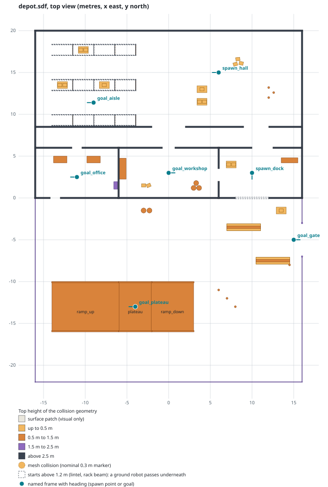

# Worlds

The worlds Fieldproof ships live in the `fieldproof_worlds` package of the `sim/` workspace
([workspaces.md](../setup/workspaces.md#the-ros-workspaces-sim-bridge-robots)), as SDF 1.11
files under `worlds/`, with the package's own primitive models under `models/` and the Gazebo
Fuel models they include pinned in `assets/fuel.lock`
([01-architecture.md](../plan/01-architecture.md#l1-physics-and-sensor-engine)). Every world
loads the same systems, so any reference vehicle spawns into any of them: Physics,
UserCommands, SceneBroadcaster, Contact, Sensors (ogre2, headless rendering), Imu and NavSat
with WGS84 spherical coordinates (an arbitrary origin on the Athens coast, ENU).

| World | Task | Contents |
| --- | --- | --- |
| `fieldproof_empty.sdf` | P0-T07 | ground plane and sun; the spawn tests of the reference vehicles use it |
| `depot.sdf` | P1-T02 | the navigation course below: a depot building with rooms, a corridor and racking aisles, and a yard with a ramp |
| marine worlds | P5-T03 | harbour with waves, wind and current |

## Physics step and real time

Every world fixes `max_step_size` at **1 ms** and `real_time_factor` at **1.0**. The step is
the one the reference vehicles were tuned with (IMU at 100 Hz, DiffDrive odometry at 50 Hz, a
camera at 15 Hz, all integer multiples of it), and it is checked by `test_worlds.py`. The
real-time factor in the file is the default of a world started by hand; the scenario runner
sets the target per the scenario's time mode ([ADR-0006](../adr/0006-sim-time-default-realtime-locked-mode.md))
through the `/world/<name>/set_physics` service, which is also how the world test lifts the cap
to measure what the machine sustains.

What limits the real-time factor is physics, not rendering. Measured on the reference
workstation (Ryzen AI 7 PRO 350, Radeon 860M through `/dev/dri`), the depot without a robot ran
uncapped at a real-time factor of 3.1 with primitive collisions only, while the first draft with
two Fuel models whose collision is a mesh (a pallet and a traffic cone, static, resting on the
ground plane) reached 0.54, and 0.32 with dynamic boxes on the mesh pallets. In gz-physics a
mesh against the ground plane costs a large share of every step, so **no model in a Fieldproof
world has a mesh collision**: Fuel models are chosen for box or cylinder collisions, and the
pallet and traffic cone are primitive models of this package. `test_worlds.py` fails when a
mesh collision appears in a world or an installed model.

## `depot`: rooms, corridors, obstacles and a slope



The map is generated from the world file by `scripts/world_map.py` (collision footprints,
coloured by top height; dashed outlines start above 0.5 m, so a robot passes underneath) and
checked for currency by `test_worlds.py`; regenerate it after editing the world with
`sim/fieldproof_worlds/scripts/world_map.py worlds/depot.sdf -o ../../docs/reference/worlds/depot-map.svg`
after `make assets`.

Coordinates are metres, x east, y north. The building (x −16..16, y 0..20) has 0.2 m walls,
3 m high, and no roof, so the sun lights every room and the camera sees indoors; the yard
(y −22..0) is fenced 1.8 m high with a 4 m gate on the east side.

| Area | Extent | What is there |
| --- | --- | --- |
| Hall | x −16..16, y 8.5..20 | three rows of four `pallet_rack_section` (2.5 m × 1.4 m × 3 m) at y 9.3, 13.5 and 17.7 with 2.8 m clear aisles; pallets with boxes in the bays and on the floor; three traffic cones around a wet patch; loose boxes |
| Corridor | x −16..16, y 6..8.5 | 2.5 m wide; opens into the hall at x −2..2 (4 m) and x 9..12 (3 m) |
| Office | x −16..−6, y 0..6 | two desks and a cabinet; door to the corridor at x −11.6..−10.4 (1.2 m); pedestrian door to the yard at x −14.2..−13 |
| Workshop | x −6..6, y 0..6 | a bench along the west wall, three drums, two loose boxes; door to the corridor at x −0.75..0.75 (1.5 m); door to the loading bay at x 6, y 2..3.5 |
| Loading bay | x 6..16, y 0..6 | counter, pallet with boxes; roller door to the yard at x 8..12 (4 m, lintel at 2.5 m); opening to the corridor at x 10..12.5 |
| Yard | x −16..16, y −22..0 | asphalt; the slope; two jersey barriers (4.1 m) as a chicane in front of the gate; cones; drums and a pallet along the building |
| Slope | x −14..3, y −16..−10 | 8 m ramp up at 10 % (x −14..−6), 4 m plateau 0.8 m high, 5 m ramp down at 16 % (x −2..3); 0.35 m kerbs on both edges |

### Spawn points and goals

The world declares named frames (`<frame name="...">` at world level) for the poses scenarios
refer to. `base_link` of the UGV sits 0.12 m above the surface, so a spawn adds that to z.

| Frame | Pose (x y z yaw) | Use |
| --- | --- | --- |
| `spawn_dock` | 10 3 0 −π/2 | in the loading bay, facing the roller door; the world test spawns here |
| `spawn_hall` | 6 15 0 π | in the hall, facing the racking aisles |
| `goal_office` | −11 2.5 0 π | through the corridor and the office door |
| `goal_workshop` | 0 3 0 0 | past the drums and loose boxes |
| `goal_aisle` | −9 11.4 0 π | inside the first racking aisle |
| `goal_plateau` | −4 −13 0.8 π | on top of the ramp |
| `goal_gate` | 15 −5 0 0 | through the chicane, at the yard gate |

Spawn the UGV into the depot by hand with the server running (`make up` starts it; inside the
dev container `gz sim -s -r --headless-rendering depot.sdf` does the same once `sim/install` is
sourced):

```bash
ros2 launch fieldproof_robots spawn_ugv_ref.launch.py world:=depot x:=10 y:=3 yaw:=-1.5708
```

### Models

| Model | Source | Collision | Licence |
| --- | --- | --- | --- |
| `pallet_rack_section` | Fuel, OpenRobotics `Pallet_Rack_Section` v1 | boxes | CC-BY-4.0 |
| `cardboard_box` | Fuel, OpenRobotics `Cardboard box` v3 | box (dynamic: a robot can push it) | CC0-1.0 |
| `jersey_barrier` | Fuel, OpenRobotics `Jersey Barrier` v6 | boxes | CC0-1.0 |
| `55gal_drum` | Fuel, OpenRobotics `55gal_Drum` v1 | cylinder | CC-BY-4.0 |
| `pallet` | `fieldproof_worlds/models/pallet` | box (1.2 m × 0.8 m × 0.144 m) | Apache-2.0 |
| `traffic_cone` | `fieldproof_worlds/models/traffic_cone` | cylinder (0.7 m high) | Apache-2.0 |

Everything else (ground, floors, walls, fixtures, fence, slope) is primitives in the world
file. Fuel and package models are included as `model://<dir>`; both kinds are installed under
`share/fieldproof_worlds/models`, which the package's environment hook puts on
`GZ_SIM_RESOURCE_PATH` next to `share/fieldproof_worlds/worlds`.

## The asset pipeline

Assets follow the convention of [`assets/README.md`](https://github.com/Dimitrios-Kafetzis/Fieldproof/blob/main/assets/README.md):
vendored files live under `assets/` with a licence file in `assets/LICENSES/`, and Gazebo Fuel
models are not vendored but pinned.

`assets/fuel.lock` records, per model, the Fuel owner and name, the version, the directory name
on the resource path, the SPDX licence (permissive only: CC0, CC-BY, Apache, MIT; no NC or ND
terms), the archive size and its SHA-256, and the worlds that use it.
`tools/assets/fetch_fuel.py` (standard library plus PyYAML, like the other host helpers):

| Command | Effect |
| --- | --- |
| `make assets` (`fetch_fuel.py`) | download the archives missing from `assets/fuel/archives`, refuse any whose digest differs from the lock, extract each into `assets/fuel/models/<dir>` with a stamp; a no-op when everything is in place, so it needs no network once cached |
| `fetch_fuel.py check` | verify offline that every archive and model directory matches the lock (exit 1 otherwise) |
| `fetch_fuel.py add OWNER/NAME --used-by depot` | pin a model: read its metadata and latest version from Fuel (`--version N` for another), download, record the digest and licence, extract |

`assets/fuel/` is ignored by git. The `fieldproof_worlds` build runs the fetch (so a fresh
clone's `make test-ros` works, with network on the first build), installs the models, and
`gz sdf --check` resolves the includes through `SDF_PATH`. `make up` runs the fetch too, and the
compose `sim` service bind-mounts `assets/fuel/models` with the worlds and the robot models
([containers.md](../setup/containers.md#compose-profiles-and-networking)). CI caches
`assets/fuel/archives` keyed on the lock, and `tests/assets/test_assets.sh` (`make test-assets`)
exercises the script against a local stand-in server: fetch, no-op, offline check, a tampered
archive refused, re-extraction from the cache, an archive entry escaping its directory refused.

## Tests

| Test | Target | Checks |
| --- | --- | --- |
| `sdf_check_<world>`, `sdf_check_model_<model>` | `make test-ros` | `gz sdf --check` on every world (with the Fuel and package models on `SDF_PATH`) and every package model |
| `test_worlds` (pytest) | `make test-ros` | physics step and systems of every world; every include pinned or local, installed and stamped; no mesh collision; the depot's frames, rooms, racks and slope; the map is current |
| `tests/worlds/test_depot.py` | `make test-worlds` | the P1-T02 verification: the depot loads with every model within `FIELDPROOF_WORLD_LOAD_LIMIT_S` (10 s), the UGV spawns at `spawn_dock` and its lidar, IMU, camera and odometry publish, the uncapped real-time factor over 30 simulated seconds is at least `FIELDPROOF_WORLD_RTF_MIN` (1.0), and the server resolved every resource |
| `tests/assets/test_assets.sh` | `make test-assets` | the asset convention, the lock and the fetch script |

`make test-worlds` runs in the dev container with the `sim` and `robots` install spaces
sourced (`tools/ros/colcon.sh run`), in a private Gazebo partition and ROS domain. On the
reference workstation the depot loads in about 2 s and runs at a real-time factor of about 2.6
with the UGV and all its sensors; CI runs the same test with software rendering and relaxed
limits (`FIELDPROOF_WORLD_RTF_MIN=0`), where it checks loading and resource resolution and
prints the factor it reached.
